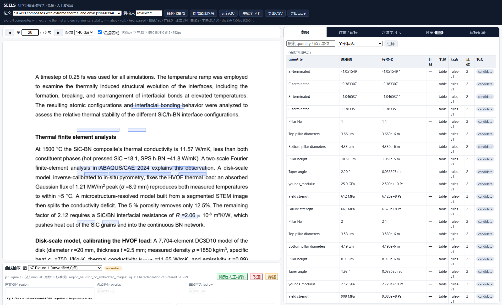
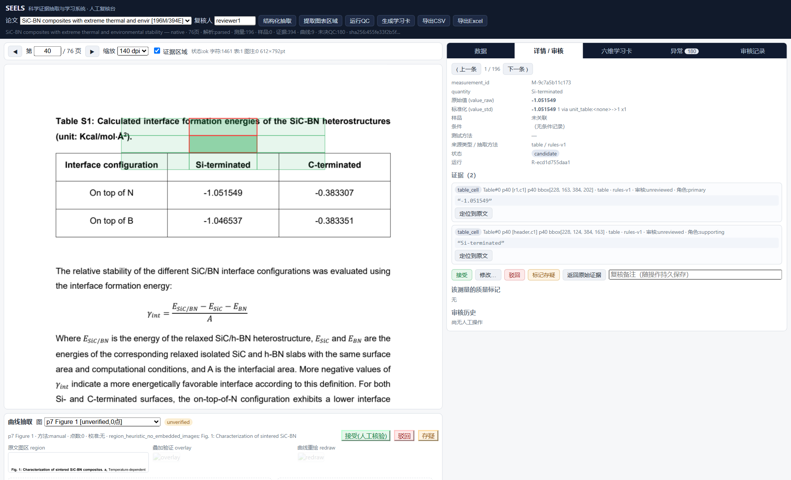
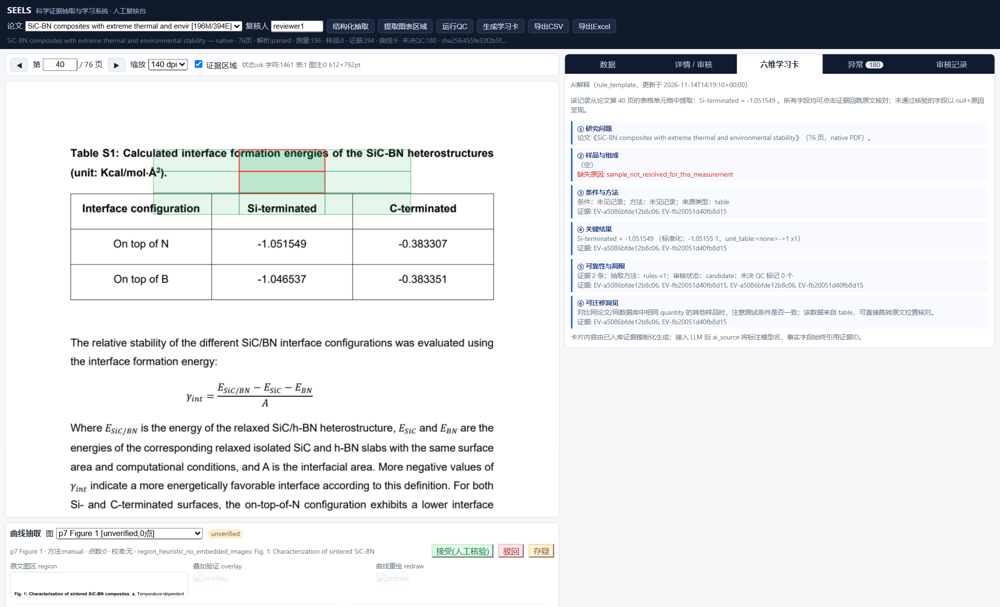
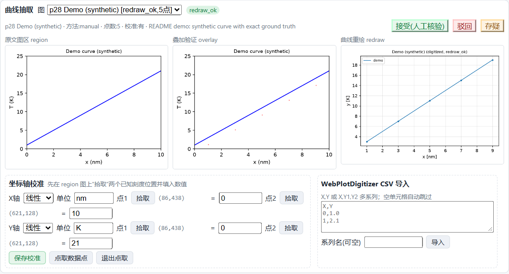
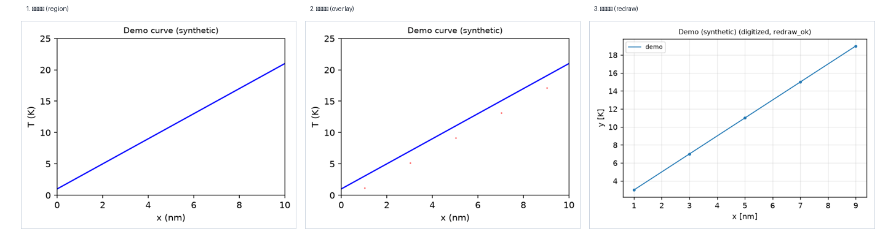
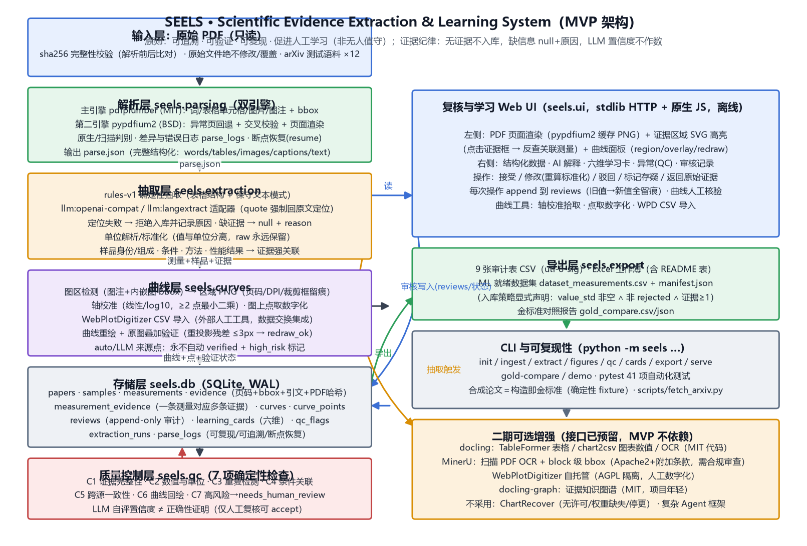
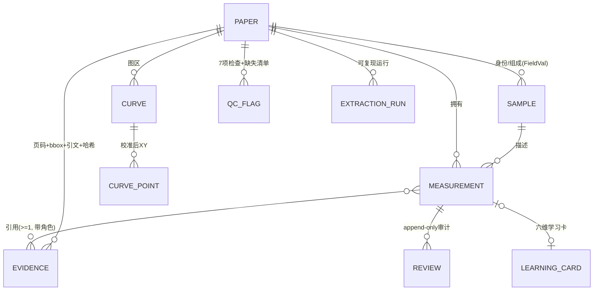

# SEELS — Scientific Evidence Extraction & Learning System

[](LICENSE)
[](#快速开始)
[](#测试与评估)
[](https://github.com/YueQiandesedianzi/Scientific-Evidence-Extraction-Learning-System-SEELS-/actions/workflows/ci.yml)
[](#已知限制与路线图)

> 从学术论文 PDF 中抽取**可追溯、可验证、可复现**的「样品 – 条件 – 性能」数据：
> 每一个数值都绑定原文页码、区域坐标与逐字引文；LLM 只能提供候选，**只有人工复核能让数据生效**。
> 目标不是无人值守，而是人机协同的论文伴读与可信数据集构建。

| 四条证据纪律 | 落地机制 |
|---|---|
| **无证据不入库** | 每条测量强制关联 ≥1 条证据（PDF sha256 + 页码 + bbox + 原文引用 + 来源类型 + 抽取方法 + 审核状态）；无证据的行在写入层直接丢弃 |
| **不静默补全** | 字段不确定 → null + 原因；LLM 引文落不回原文 → 整条拒绝并留档；缺失全部变成可见 QC 标记 |
| **LLM 置信度 ≠ 正确性** | 置信度仅存档展示；accepted / human_verified 只能由人工复核动作触发 |
| **原始 PDF 只读** | 解析前后 sha256 比对；一切派生物写入 data/work/ |

---

## 界面速览（真实运行截图）

**① 复核主界面** — 左侧：PDF 页面渲染 + 证据区域高亮（蓝=正文、绿=表格单元格、橙=图注；悬停看引文，点击反查测量）；右侧：结构化数据表。截图为 arXiv 2611.17283（76 页 SiC-BN 复材论文）第 28 页：

<p align="center"></p>

**② 测量详情 / 审核**（全字段 + 逐条证据「定位到原文」+ 接受 / 修改 / 驳回 / 存疑 / 返回原始证据，修改自动重算标准化并保留旧值）　**③ 六维学习卡**（事实字段全部引用证据 ID）：

<p align="center">
  
  
</p>

**④ 曲线抽取面板** — 原文图区 / 叠加验证 / 曲线重绘三联 + 轴校准拾取、点取数字化、WebPlotDigitizer CSV 导入（下图中曲线为**合成演示数据**：真值校准，叠加残差 0.0px）：

<p align="center"></p>

曲线数据闭环（真实模块输出拼接）：**原图区 → 数字化点叠加回原图验证 → 独立重绘比对**：

<p align="center"></p>

## 架构总览



解析（双引擎）→ 抽取（规则 + LLM 适配器，强制引文落地）→ 曲线（校准/点取/回绘验证）→ SQLite 存储 → 七项 QC → 复核学习 Web UI → CSV / Excel / ML 数据集导出。模块边界、坐标约定与幂等机制详见 [docs/02-architecture.md](docs/02-architecture.md)（另有[生图模型示意版](docs/assets/architecture-ai.png)）。

## 功能特性

- **高保真解析** — pdfplumber（主）+ pypdfium2（备/渲染）双引擎；原生/扫描自动判别；异常页自动回退并记录差异日志；词/表格单元格/图注/图片全部带 bbox；断点恢复
- **结构化抽取** — 确定性 rules-v1（表格结构 + 保守文本模式）；llm:openai-compat 与 llm:langextract 适配器（引文强制回原文定位，失败即拒绝）；单位标准化与原始值分离；歧义符号（σ/ρ/κ…）标记待人工消歧而非猜测
- **曲线抽取** — 图区自动检测；轴校准（线性/log10）；图上点取；WebPlotDigitizer CSV 导入；重绘 + 原图叠加验证（重投影残差 ≤3px）；auto/LLM 来源永不自动通过
- **质量控制** — 证据完整性 / 数值单位重算 / 重复检测 / 条件关联 / 跨源一致性 / 曲线回绘 / 高风险转人工，共 7 项确定性检查
- **复核与学习** — 本地 Web UI（无外网/CDN 依赖），六维学习卡，append-only 审核审计
- **导出** — 9 张审计表 CSV、Excel 工作簿、ML 就绪数据集（入库策略写入 manifest）、金标准误差对照报告

## 快速开始

**方式 A：直接用自己的论文 PDF**

<details open>
<summary><b>Windows</b></summary>

```powershell
cd SEELS
python -m venv --system-site-packages .venv
.venv\Scripts\pip install -r requirements.txt -r requirements-dev.txt

.venv\Scripts\python -m seels ingest 你的论文.pdf      # 解析入库（原件只读）
.venv\Scripts\python -m seels papers                  # 查看论文 ID（形如 P-xxxxxxxxxxxxxxxx）
.venv\Scripts\python -m seels extract all             # 结构化抽取（rules-v1，零外部依赖）
.venv\Scripts\python -m seels figures all             # 图区检测（曲线抽取入口）
.venv\Scripts\python -m seels qc all                  # 七项质量检查
.venv\Scripts\python -m seels cards all               # 六维学习卡
.venv\Scripts\python -m seels serve                   # 打开 http://127.0.0.1:8765 复核
```

> 也可作为 Python 包安装：`pip install -e .`（提供全局 `seels` 命令）；CI 见 .github/workflows/ci.yml，每次 push 自动跑 41 项测试。

</details>

<details>
<summary><b>Linux / macOS</b></summary>

```bash
cd SEELS
python3 -m venv .venv && source .venv/bin/activate
pip install -r requirements.txt -r requirements-dev.txt

python -m seels ingest /path/to/paper.pdf
python -m seels extract all && python -m seels figures all
python -m seels qc all && python -m seels cards all
python -m seels serve        # http://127.0.0.1:8765
```

</details>

**方式 B：复现论文中的评估**（12 篇 arXiv 开放获取语料不随仓库分发，需外网重新下载）

```powershell
.venv\Scripts\python scripts\fetch_arxiv.py       # 下载 12 篇测试语料 -> data/papers/（含 manifest 与 sha256）
.venv\Scripts\python scripts\corpus_report.py     # 全语料流水线：解析->抽取->图区->QC->学习卡->导出（冷启动约 4 分钟）
.venv\Scripts\python -m seels demo data\papers\arxiv_2611.17283.pdf   # 或对单篇跑完整演示
```

> 端口被占用时：`python -m seels serve --port 9000`。
> 数据目录/库文件可用环境变量迁移，见文末「配置」。

## 复核工作流（对照上方截图）

1. 顶栏选择论文 → 左侧自动渲染第 1 页，右侧「数据」页列出全部测量与样品
2. 点击任一测量行 → 跳转其证据所在页并**红框闪烁**定位；「详情/审核」显示全字段与逐条证据
3. 核对无误点 **接受**；有错点 **修改…**（改原始值/单位后自动重算标准化，旧值留档）；不可信点 **驳回**；拿不准点 **标记存疑**
4. 「六维学习卡」页签伴读：研究问题 / 样品组成 / 条件方法 / 关键结果 / 可靠性局限 / 可迁移洞见
5. 曲线：左下曲线面板选图 → 图上**拾取**两个 X 轴、两个 Y 轴已知刻度点并填数值 → 保存校准 → 沿曲线**点取数据点**（或粘贴 WebPlotDigitizer CSV 导入）→ 查看 overlay 残差与 redraw → **接受(人工核验)** 后状态才变为 human_verified
6. 每次操作都写入「审核记录」（append-only），顶栏可一键运行 QC / 导出

## 常用命令

```text
python -m seels init                     # 建目录与数据库 schema
python -m seels ingest a.pdf b.pdf       # 解析入库（默认断点恢复；--force 全量重解析；--meta 元数据JSON）
python -m seels papers                   # 库存清单（论文 ID / 状态 / 计数）
python -m seels extract REF              # 结构化抽取；REF = 论文ID / ID前缀 / PDF路径 / all
python -m seels figures REF              # 图区检测 -> 曲线记录
python -m seels qc REF                   # 七项质量检查
python -m seels cards REF                # 生成六维学习卡
python -m seels export --fmt both        # CSV + Excel + ML 数据集（--paper 限定单篇，--out 指定目录）
python -m seels gold-compare REF --gold data/gold/xxx.json    # 金标准误差对照（CSV+JSON 报告）
python -m seels serve                    # 复核与学习 Web UI
```

**LLM 抽取器（可选，证据纪律不变）**

```powershell
# 任意 OpenAI 兼容端点（OpenAI / DeepSeek / vLLM / Ollama / LM Studio…）
python -m seels extract P-xxxx --extractor llm:openai-compat --cfg-json "{\"endpoint\":\"https://api.deepseek.com/chat/completions\",\"api_key\":\"sk-...\",\"model\":\"deepseek-chat\"}"

# google/langextract（需 pip install langextract；云 key 或本机 Ollama）
python -m seels extract P-xxxx --extractor llm:langextract --cfg-json "{\"model_id\":\"gemma2:2b\",\"model_url\":\"http://localhost:11434\"}"
```

LLM 输出的每条记录必须携带逐字 quote；quote 无法在该页词流中落地（相似度 <0.90）→ 整条**拒绝入库**并写入运行统计供审计；值不可解析 → null + 原因。LLM 置信度只存档、不参与任何状态晋升。

## 数据模型



字段级溯源统一采用 FieldVal 契约：**value 与 null_reason 互斥——有值必有证据，无值必有原因**。完整 DDL、状态机与导出契约见 [docs/03-schema.md](docs/03-schema.md)。

## 测试与评估

```powershell
python -m pytest tests -q     # 41 passed（单元+集成：解析/抽取/曲线/QC/导出/API 全链路）
```

| 评估层 | 结果（2026-11-14，rules-v1 0.2.0 时点） |
|---|---|
| 合成论文 · 精确金标准（构造即真值，pytest 守护） | **8/8 匹配，相对误差 0.000**；篡改值→MISMATCH、虚构条目→MISSING 均正确报出 |
| 真实论文 · 部分金标准（arXiv 2611.17283，76 页，8 项核读标注） | **8/8 匹配，相对误差全部 0.000**，召回 100%；**0 编造数值**（0.1.0 时为 4/8，升级记录与金标准修订说明见评估报告 §3） |
| 12 篇 arXiv 语料（4 个子领域，280 页）端到端 | 解析 0 失败页；220 测量 / 447 证据 / 72 图区 / 220 学习卡；QC 未决标记 420 条全部可见；ML 数据集 196 行、100% 带证据 |
| 全流水线耗时 | 首次冷启动 243.7 s；缓存热重跑 6.8 s |

细节、逐条对照与复现命令：[docs/04-evaluation.md](docs/04-evaluation.md)。表中数字随语料与规则版本变化，以重新运行的报告为准。

## 项目结构

    seels/            核心包：parsing · extraction · curves · qc · learning · export · ui · db · cli
    tests/            pytest 41 项（金标准、LLM 拒绝未落地引文、曲线真值恢复、审核状态机…）
    scripts/          fetch_arxiv.py · corpus_report.py · make_arch_diagram.py · make_readme_assets.py
    data/papers/      原始 PDF（只读，不分发）+ manifest.json（来源 URL 与 sha256）
    data/gold/        金标准：合成精确版 · 真实论文部分版[PROVISIONAL] · 人工标注模板
    data/work/        派生物：seels.sqlite3 · parse.json · renders · curves · exports（可全量再生）
    docs/             可行性报告 · 架构 · Schema · 评估 · 限制与路线图 · assets（图示）

## 文档索引

| 文档 | 内容 |
|---|---|
| [01 技术可行性报告](docs/01-feasibility-report.md) | 8 个开源项目逐项核实（维护/许可/部署/API/定位/限制）与选型决策、风险登记 |
| [02 系统架构](docs/02-architecture.md) | 架构图、模块边界、坐标约定、幂等与断点恢复、LLM 证据纪律 |
| [03 数据 Schema](docs/03-schema.md) | 全部表结构、FieldVal 契约、状态机、导出契约 |
| [04 评估报告](docs/04-evaluation.md) | 金标准误差对照、12 篇语料端到端结果、复现命令 |
| [05 已知限制与路线图](docs/05-limitations-roadmap.md) | 18 项如实限制 + P1/P2/P3 计划 + 系统边界（明确不做什么） |
| [06 图区识别升级方案](docs/06-figure-recognition-upgrade-plan.md) | 图区检测问题审计 + 版面引擎（docling/MinerU）接入完整方案（待决策） |

<details>
<summary><b>验收标准对照（点击展开）</b></summary>

| 验收项 | 实现与验证 |
|---|---|
| 正式入库数值均具备来源证据 | 写入层强制（无证据不入库）+ QC C1 复核 + tests/test_extraction |
| 数据库记录 ↔ PDF 位置跳转 | UI 每条证据「定位到原文」→ 页面渲染 + 红框闪烁；证据含页码/bbox/引文/PDF 哈希 |
| 曲线查看、校准与复核 | 曲线面板 region/overlay/redraw + 校准拾取 + WPD 导入 + 人工核验；tests/test_curves |
| 错误与缺失不静默补全 | null+reason · uncertain→EX_NULL_FIELD · LLM 未落地引文拒绝留档；测试覆盖 |
| 人工复核结果持久保存 | reviews 表 append-only（旧值→新值/复核人/时间/备注）；tests/test_server |
| ≥10 篇不同类型论文测试 | 12 篇 arXiv + 合成原生 + 模拟扫描 fixture；docs/04 §4 |
| 金标准与自动抽取误差对照 | data/gold/* + gold-compare 命令（CSV/JSON 报告）；docs/04 §2–3 |
| 可导出 ML 数据集 | dataset_measurements.csv + dataset_manifest.json（入库策略显式声明） |

</details>

## 配置

| 环境变量 | 默认 | 说明 |
|---|---|---|
| SEELS_DATA_DIR | 仓库内 data/ | 数据根目录（papers 原件 / work 派生物 / gold 金标准） |
| SEELS_DB | data/work/seels.sqlite3 | 数据库文件路径 |
| SEELS_UI_HOST | 127.0.0.1 | UI 绑定地址（默认仅本机） |
| SEELS_UI_PORT | 8765 | UI 端口（亦可用 serve --port 覆盖） |

## 许可

- 本仓库代码：**MIT**（见 [LICENSE](LICENSE)）
- 运行依赖均为宽松许可：pdfplumber / pdfminer.six（MIT）· pypdfium2（BSD/Apache-2.0）· matplotlib · pandas / numpy / openpyxl / Pillow；开发依赖 pytest、fpdf2（仅测试夹具）、playwright（仅 README 截图脚本）
- WebPlotDigitizer（AGPL-3.0）仅作为**外部自托管人工工具**经 CSV 数据交换集成，不链接其代码
- 可选二期组件（docling MIT · MinerU Apache-2.0+附加条款 · langextract Apache-2.0 · docling-graph MIT）未进入 MVP 依赖，接入前按可行性报告 §3–4 复核
- 测试论文来自 arXiv 开放获取，版权归原作者；仓库仅保留来源清单与 sha256

## 已知限制与路线图

要点：OCR 未捆绑（扫描页如实标记 needs_ocr，不静默降级）· rules-v1 对符号密集论文召回有限（LLM 适配器为既定提升路径）· 真实论文金标准为 AI 辅助临时标注（PROVISIONAL，待专家复核）· 曲线点与测量行尚未正式关联。完整 18 项限制与 P1/P2/P3 计划见 [docs/05-limitations-roadmap.md](docs/05-limitations-roadmap.md)。
