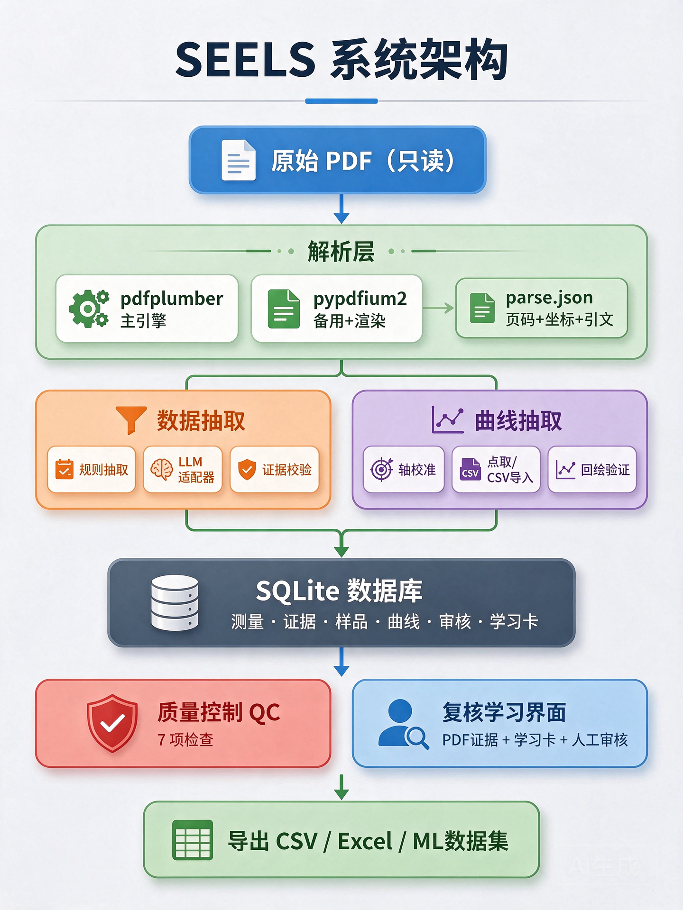
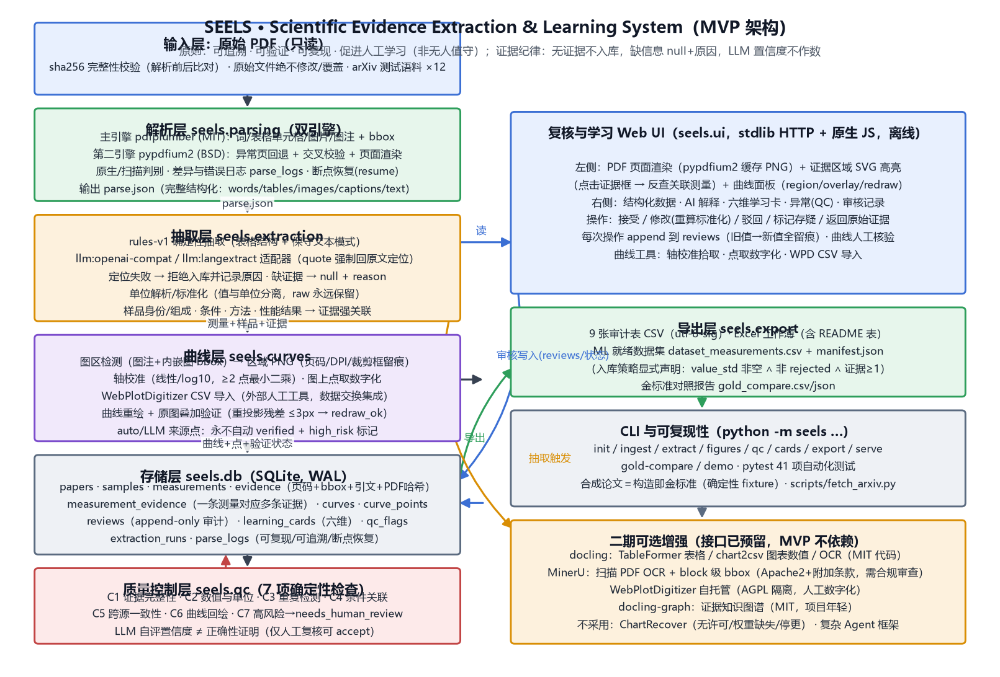

# SEELS 系统架构

（示意版由 Doubao-Seedream-5.5 生图模型生成；若个别文字渲染有误，以下方文字精确版为准）

（文字精确版由 scripts/make_arch_diagram.py 生成，可用同脚本再生）

## 1. 设计目标与原则

SEELS 面向学术论文 PDF 的证据抽取与人工学习，**不以完全无人值守为目标**。四条硬原则贯穿全部模块：

1. **可追溯**：每条入库数值必须携带 ≥1 条证据（PDF 哈希 + 页码 + 区域坐标 + 原文引用 + 来源类型 + 抽取方法）。
2. **可验证**：证据可被确定性重校验（quote 重定位、标准化重算、曲线重投影残差）；LLM 自评置信度永远不作为正确性证明，只有人工复核能把数据置为 accepted / human_verified。
3. **可复现**：解析/抽取运行记录（extraction_runs、parse_logs）、确定性证据 ID、断点恢复、固定依赖版本；合成测试论文"构造即金标准"。
4. **不静默**：缺证据 → null + 原因；解析失败 → 第二引擎 + 差异日志；不确定 → uncertain 记录 + QC 标记；原始 PDF 只读（解析前后 sha256 比对）。

## 2. 模块划分（低耦合，接口边界清晰）

    seels/
      config.py          路径与阈值（环境变量可覆写 SEELS_DATA_DIR / SEELS_DB / SEELS_UI_PORT）
      util.py            id/哈希/时间/JSON + quote 定位（词级模糊匹配→bbox）
      models.py          核心实体的规范形状（文档性 dataclass）
      db.py              SQLite 存储层（唯一持久化入口；reviews append-only）
      parsing/
        base.py          ParseEngine 接口 + 规范坐标约定 + 页面判别助手
        engine_pdfplumber.py   主引擎（MIT）
        engine_pypdfium2.py    第二引擎 + 渲染器（BSD/Apache）
        pipeline.py      ingest：判别原生/扫描→逐页解析→异常回退→parse.json→哈希复核
      extraction/
        units.py         值/单位解析 + 标准化注册表（歧义→null+reason）
        schema.py        目标 Schema（样品/组成/条件/方法/性能）+ FieldVal 契约 + LLM 提示词
        rules.py         rules-v1 确定性抽取器（表格结构 + 保守文本模式）
        llm.py           ground_items（quote 强制落地）+ openai-compat / langextract 适配器
        pipeline.py      run_extraction：运行记录→物化（证据先入库再链接）→uncertain→flags
      curves/
        calibrate.py     轴校准（线性/log10，最小二乘）pixel↔data 双向映射
        digitize.py      WPD CSV 解析、像素点换算、来源策略（auto/LLM 永不自动 verified）
        figures.py       图区检测（图注+内嵌图 bbox）→ 区域 PNG → 曲线记录（确定性 ID，幂等）
        redraw.py        曲线重绘 + 原图叠加验证（重投影残差）
      qc/checks.py       七项确定性检查 + run_qc（只动 candidate，人工决定不可覆盖）
      learning.py        六维学习卡（模板生成，事实字段全部引用证据 ID）
      export/            common.py 行收集 / csv_export.py / excel_export.py
      ui/server.py       stdlib ThreadingHTTPServer：JSON API + 静态单页应用（全局锁串行化 DB）
      ui/static/         index.html / app.js / style.css（原生 JS，无 CDN，可离线）
      cli.py             统一命令行入口
      gold.py            金标准对照评估器

依赖方向（单向，无环）：

    cli / ui.server → parsing / extraction / curves / qc / learning / export → db → util/config

## 3. Mermaid 数据流

    flowchart TD
      PDF[原始 PDF 只读 + sha256] --> P[解析层 ingest]
      P -->|primary| PL[pdfplumber 词/表/图注 bbox]
      P -->|异常页回退/渲染| PI[pypdfium2]
      PL --> PJ[parse.json 完整结构化]
      PI --> PJ
      P --> PLOG[parse_logs 差异/错误日志]
      PJ --> EX[抽取层 run_extraction]
      EX -->|rules-v1| G[grounding: quote→page+bbox]
      EX -->|llm 适配器| G
      G -->|定位失败| REJ[拒绝入库 + 原因记录]
      G -->|缺值| UNC[null + reason → EX_NULL_FIELD flags]
      G --> DB[(SQLite: samples/measurements/evidence)]
      PJ --> CV[曲线层 extract_figures]
      CV --> CAL[校准/点取/WPD CSV 导入]
      CAL --> RD[重绘 + 叠加验证]
      RD --> DB
      DB --> QC[QC 七项检查 → qc_flags / needs_human_review]
      DB --> UI[复核 Web UI：证据高亮/学习卡/审核操作]
      UI -->|reviews append-only| DB
      DB --> EXP[CSV / Excel / ML 数据集 + manifest]
      DB --> GOLD[金标准对照 gold-compare]

## 4. 关键机制

### 4.1 坐标约定
全系统统一 **top_left_pts**：原点=页面左上角，单位=PDF 点（1/72 英寸），y 向下，bbox=[x0,y0,x1,y1]。
- pdfplumber 原生即此约定（x0/top/x1/bottom）。
- pypdfium2 charbox 返回 (left,bottom,right,top) 左下原点，适配层做 top_tl = H − top_bl 换算（scripts/_probe2.py 实证标定，tests 守护）。
- 渲染图像素 = pt × dpi/72；UI 叠加层用 viewBox=页面 pt 尺寸自动随图缩放。

### 4.2 证据与幂等
- 证据 ID 确定性：EV- = sha256(paper|page|kind|ref|quote|bbox)[:16] —— 重复运行天然去重。
- 测量 ID 随机（每次运行新建），旧 candidate 由 delete_candidate_run_data 按 (paper, extractor) 清理；**人工评审过的行永不删除**。
- 曲线 ID 确定性（paper|page|ref|region 哈希）——图区提取幂等。

### 4.3 断点恢复
- ingest：parse.json 已有且页数一致 → 只补解析 failed 页（--force 全量重解析）。
- extraction：run 状态记录（running/done/failed）；崩溃后重跑同 extractor 自动替换 candidate。
- 渲染/导出均为幂等缓存。

### 4.4 并发与线程模型
UI 服务器 ThreadingHTTPServer + 全局互斥锁串行化所有 DB 访问（sqlite check_same_thread=False 有锁保护）；CLI 单线程。无多写者场景。

### 4.5 LLM 证据纪律（llm.py）
1. LLM 必须输出 quote（原文逐字）+ page；
2. quote 用词级模糊匹配（≥0.90）落地为 bbox，落地失败 → 整条拒绝（rejected 记录进 run stats 供审计）；
3. 值不可解析 → uncertain（null+reason），不入库；
4. LLM confidence 仅存档展示，不参与任何状态晋升；
5. langextract 路径利用其 char_interval（未对齐自动丢弃），字符偏移经 [[PAGE:n]] 标记映射回页码，再做词级落地。

## 5. 部署形态

- 单机本地：venv（Python 3.12）+ 本仓库；数据全部落在 data/（papers 原始件只读、work 派生物、gold 金标准）。
- Web UI：127.0.0.1:8765（可配），浏览器打开即用，无外网依赖。
- 二期可选：docling / MinerU 作为 ParseEngine 新实现接入；WPD 自托管容器作为外部人工数字化工具。
